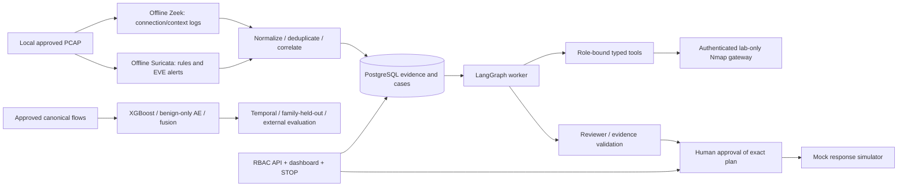
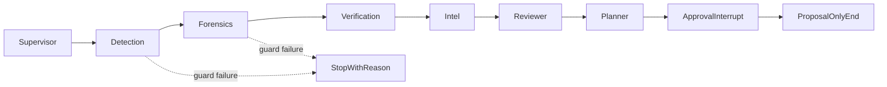

# Multi-Agent Cyber Defense System

A defensive lab project combining **offline Zeek/Suricata telemetry**, CPU **XGBoost + PyTorch autoencoder** flow scoring, and a **LangGraph investigation workflow** with evidence-linked hypotheses, fixed scope guards, human approval and simulated response.

**Current status:** runnable development implementation and generated-data evaluations. This is not a validated production IDS. Authoritative dataset terms and a key CIC reanalysis have now been reviewed; exact archive/variant approval, public-data benchmarks, hosted-model evaluation, 30 human report reviews and laptop resource measurements remain outstanding. [Source review](DATA_SOURCES.md) and [selected hosted model](docs/HOSTED_EVALUATION.md) record the current findings and prerequisites. [Phase-by-phase status and commands](docs/PHASES.md) distinguish implemented code from unperformed research. CrewAI, AutoGen and heavier GPU models are optional and not implemented.

> Defensive and authorized scope only. Scanning systems you do not own or lack written authorization to test can be illegal. Nmap accepts only two fixed isolated lab assets. There is no real response enforcement. Read [SAFETY.md](SAFETY.md) before running the lab.

[Executed checks, honest result tables and sample report](reports/VALIDATION.md) · [Sample hypotheses](reports/sample-incident-report.json)

## Architecture





Zeek logs describe connections, DNS, HTTP and TLS context; they are observations, not automatic maliciousness labels. Suricata EVE can contain signature alerts alongside protocol and flow records; a rule match still needs investigation. The bundled rule deliberately alerts on harmless `example.com` DNS so the sensor-to-case path can be exercised without malware or attacks.

## Quick start — LOCAL, Python 3.12, Linux / WSL2

Use the existing checkout. Each Codex task already has its own isolated environment; do not create a Git worktree unless explicitly requested.

```bash
git clone https://github.com/GaurikMehrotra/Multi-Agent-Cyber-Defense-System.git
cd Multi-Agent-Cyber-Defense-System
python3.12 -m venv .venv
source .venv/bin/activate
python -m pip install --upgrade pip==26.2.1
python -m pip install -r requirements.txt
python scripts/init_env.py
mkdir -p runtime data/pcaps data/zeek data/suricata artifacts
export LOCAL_UID="$(id -u)" LOCAL_GID="$(id -g)"
make lint test audit safety demo
make detection-eval agent-eval
```

If `.env` already exists, preserve it and skip `init_env.py`. It generates fresh keys and a DB password without displaying them. Do not copy it into images or Git. Exact resolved versions are in `requirements.txt`, including CPU-only PyTorch and `xgboost-cpu`; the extra PyTorch index uses verified TLS. Packages/images/APIs change: use the pinned versions first, consult current upstream documentation if commands fail, and rerun the checks when updating pins. Never disable TLS, package signatures or checksum checks.

Expected: tests pass; safety reports no escapes; demo ends `awaiting_human_approval` with an `escalate` hypothesis. Generated model artifacts, evaluation CSV/JSON, SHAP arrays, plots and caches live under ignored `artifacts/`. The demo intentionally does not approve its own proposal.

## PostgreSQL, API and dashboard — profiles core / agents

```bash
docker compose --profile core up -d postgres
python scripts/migrate.py
docker compose --profile agents build api worker dashboard
docker compose --profile agents up -d api worker dashboard
docker compose --profile agents ps
```

Migrations are mandatory before queue use. Alternative that also works when a cloud daemon's localhost ports are not reachable from the shell:

```bash
docker compose --profile agents run --rm --no-deps api alembic upgrade head
```

Local laptop: API port 8000, dashboard port 8501, PostgreSQL port 5432, all bound to loopback. Open the dashboard locally in your own browser; enter `LOCAL_API_KEY` from your private `.env`. No cloud onboarding web preview is supplied. OpenAPI is authenticated (`X-API-Key`), as are events, cases, approvals, overrides and network state. Only admins can approve, override, stop or resume. To use reader/analyst roles, generate additional random keys and add their SHA-256 hashes plus role/actor to `API_KEY_RECORDS`; never use the testing keys in deployments.

API development limits: 64 KiB request bodies, at most 100 records/page, 60 requests/key/minute and one process. The in-memory limiter is not multi-instance production infrastructure. Reports contain hypotheses, trace and evidence IDs. Administrative approval applies only to a mock network; ground truth malicious labels are unavailable in live cases and never guessed for scoring.

Threat enrichment defaults to an explicit unknown-reputation mock. An optional bounded HTTPS client supports an operator-owned service contract, with export consent and hostname validation; see [enrichment configuration](docs/INTEL.md). No vendor API or live enrichment result is assumed.

## Offline sensors — profile detect

```bash
make sensors
# Or use Compose, sequentially to conserve memory:
export LOCAL_UID="$(id -u)" LOCAL_GID="$(id -g)"
python scripts/benign_pcap.py
mkdir -p data/zeek data/suricata
docker compose --profile detect run --rm zeek
docker compose --profile detect run --rm suricata
python -m src.sensors.ingest --zeek data/zeek --eve data/suricata/eve.json
```

The tiny PCAP is generated offline by code and never committed. `make sensors` writes content-addressed output directories and `runtime/sensors-latest.json`; ingest with no path arguments follows that manifest. The Compose alternative writes directly to data/zeek and data/suricata, so its ingestion uses explicit paths. Reprocessing does not create new observations merely because a sensor UID changed. Sensors have `network_mode: none`, read-only PCAP mounts, no capabilities and 384 MiB limits. Parsers support JSON and ASCII Zeek logs; malformed/truncated rows are counted rather than silently treated as valid. EVE metadata without entity addresses is skipped/accounted separately. Ingestion deduplicates by normalized content hash and creates queued cases from new Suricata alerts. Querying and correlation use entity/time windows, not causal claims.

## Isolated lab — profile lab

```bash
export LOCAL_UID="$(id -u)" LOCAL_GID="$(id -g)"
docker compose --profile lab build nmap traffic
docker compose --profile lab up -d web web2 nmap
docker network inspect cyber-defense_lab --format '{{.Internal}} {{json .IPAM.Config}}'
docker inspect cyber-defense-nmap-1 --format '{{json .NetworkSettings.Networks}}'
docker compose --profile lab run --rm traffic
python -m src.sensors.lab_checksums data/pcaps/lab.pcap data/pcaps/lab-repaired.pcap
PYTHONPATH=. python scripts/sensors.py data/pcaps/lab-repaired.pcap
python -m src.sensors.ingest
```

Expect `Internal=true`, subnet `172.30.0.0/24`, and exactly one scanner network. Never substitute host networking or attach Nmap to another network. Traffic generation is finite, fixed-target HTTP with one-second spacing. Capture is the generator container's own eth0; never host capture. NIC checksum offloading can leave recorded checksum fields invalid; the scoped offline helper preserves the original and writes a derived PCAP plus hashes, changing checksum fields only. It refuses non-lab/fragmented traffic and different existing outputs. No sensor checksum checks are disabled. Benign lab traffic may produce zero suspicious alerts, which is a valid result. The tiny offline DNS fixture is the deterministic alert smoke test.

Verification defaults to a labelled mock, including in CI. For an explicitly authorized lab verification through the isolated gateway:

```bash
# Add VERIFY_MODE=lab to your private .env, then:
docker compose --profile agents up -d --force-recreate worker
```

The worker has only internal core/lab networks, no Docker socket. The gateway validates again, uses a secret key and serializes scans with a ten-second minimum interval. Read `SAFETY.md`: IP scope checks alone do not prove Docker topology. Do not scan outside the prescribed assets.

## Public data evaluation — required owner review first

Read [DATA_SOURCES.md](DATA_SOURCES.md), verify CURRENT licenses, terms, citations, corrected variants and published labeling/flow-construction analyses, and create truthful local manifests. No project code auto-downloads public data or accepts implicit approval. Canonical CSV schema/units are listed there.

```bash
python -m src.eval.datasets data/source.csv data/source.manifest.json --output data/flows/source.csv
python -m src.eval.run_detection \
  --source data/flows/source.csv --source-manifest data/source.manifest.json \
  --target data/flows/external.csv --target-manifest data/external.manifest.json \
  --held-out YOUR_ACTUAL_HELD_OUT_FAMILY --benign-days YOUR_MEASURED_BENIGN_EXPOSURE \
  --config configs/default.yaml --output artifacts/public-eval
```

Replace the two descriptive arguments with verified values from your approved data; they are required research inputs, not invented results. No random split exists. Exact flows are deduplicated first; identical timestamps cannot cross temporal partitions. Held-out attack families are absent from both training and validation. Cross-dataset source identities must differ. All model preprocessing fits training only; AE fits benign training only. Use the same validation threshold-search budget for all methods. Benign exposure days must be measured from collection coverage, not guessed from the number of rows.

For already-reviewed data, score and queue ML evidence after evaluation:

```bash
python -m src.detect.replay data/flows/external.csv data/external.manifest.json --model-dir artifacts/public-eval --output artifacts/replay.json
python -m src.detect.store_scores artifacts/replay.json artifacts/public-eval/metadata.json
```

Use a threshold selected on validation for your actual model and pass it to replay with `--threshold`; the default 0.5 is only a fixed-threshold diagnostic. These queued scores are hypotheses with model-manifest provenance, never approval or ground truth.

`run_detection` produces per-family recall, precision, FPR, alerts/day, calibration diagnostics, fixed and validation-selected thresholds, 3-seed mean/sample std, SHAP attributions, model checkpoints and a plot. Generated-A/generated-B exercise these APIs but do not validate public cross-dataset generalization. Alerts/individual flows may require session aggregation before comparing workload to a deployed SOC.

## LLMs, baselines and response evaluation

`src/llm/` provides FakeLLM (default), local Ollama and opt-in hosted OpenAI-compatible HTTPS. Model provenance and hashes are audited; JSON responses are schema-validated and cached locally. Never assume a free tier, current model name, pricing or quota. Check your provider's current documentation/terms. No hosted key is supplied.

For light local testing, install Ollama from its official instructions, review the model license and resource footprint, then:

```bash
ollama pull qwen2.5:0.5b
# With Ollama running locally and PostgreSQL reachable:
# Set LLM_BACKEND=ollama in private .env.
python -m dotenv run -- python -m src.api.worker
```

Ollama and hosted calls are not enabled in the internal-only Compose network. Run a host worker against loopback PostgreSQL for those optional runs, keeping mock verification. Do not add external networking to Nmap or lab services. For hosted runs set `LLM_BACKEND=hosted`, reviewed `LLM_BASE_URL`, `LLM_MODEL`, `LLM_API_KEY` and `ALLOW_EXTERNAL_LLM=yes` privately. Export only approved/redacted telemetry. Run comparison with the same backend factory for all methods; see `docs/EVALUATION.md`.

```bash
make agent-eval
make safety
python -m src.eval.response_eval
python -m src.eval.replay_eval
```

The comparison runs six authored scenarios × three repeats × six modes (multi-agent, fixed pipeline, single-call, and three ablations). It records actual calls, estimated tokens, reference grounding, typed-tool validity, scope violations, latency, failures, decision accuracy and consistency. Valid references do not prove factual support. Null costs remain unknown. Reviewer ablation never disables mandatory safety guards. Manual review requires 30 humans' assignments in the generated CSV; automated generation does not complete that review.

Optional [framework comparisons](docs/OPTIONAL_FRAMEWORKS.md) and [Kaggle cells](docs/KAGGLE.md) are documented without invented executed results. [Reuse guidance](docs/REUSE.md) describes safe refactoring from SOC/malware projects that were not supplied.

## Hardware, resource checks and reproducibility

On Windows, set `%UserProfile%/.wslconfig`:

```ini
[wsl2]
memory=6GB
processors=4
swap=2GB
```

Then run `wsl --shutdown` in PowerShell and reopen WSL. Monitor `free -h`, `df -h` and `docker stats --no-stream`. API/worker/dashboard use a separate, smaller runtime-only lockfile; ML training runs in the development environment. Runtime limits sum to about 4.8 GiB with every service, but run only the needed profile and one sensor at a time. Docker image builds and optional Ollama consume additional disk/RAM; do not build/evaluate while all profiles run. Actual laptop peaks are unmeasured. CPU training is small; no GPU is required.

```bash
python scripts/measure.py --output artifacts/local-detection-resources.json -- python -m src.eval.run_detection
docker stats --no-stream > artifacts/docker-resources.txt
make clean
```

`measure.py` reports this machine's command peak, not aggregate container RAM. [MODEL_CARD.md](MODEL_CARD.md) explains scientific limits. [THREAT_MODEL.md](THREAT_MODEL.md) explains trust boundaries and residual risks. Image tags are digest-pinned; OS packages use signed repositories. The prepared cloud instance required its supplied HTTPS proxy and CA as ephemeral build secrets; no proxy credentials or CA are copied into images/source.

## Verification and contributing

```bash
make lint test audit safety demo
python scripts/check_git.py
git status --short
```

CI runs lint/format, pytest, Bandit and pip-audit (including source-version advisory checks for the official CPU PyTorch/XGBoost distributions) with generated fixtures/FakeLLM and mocked tools only. CI never scans, captures, launches sensors or requests a real LLM. A common-token/history checker supplements `.gitignore` but is not an exhaustive secret detector. Inspect staged diffs before committing.

The repository already exists; `gh repo create` is not needed. For a new personal fork only, after authenticating with GitHub through your normal secure workflow:

```bash
gh repo create YOUR_NEW_REPOSITORY --private --source=. --remote=fork
```

For this repository:

```bash
git add src app configs docker lab migrations scripts tests notebooks docs reports .github README.md SAFETY.md THREAT_MODEL.md DATA_SOURCES.md MODEL_CARD.md Makefile requirements.txt requirements-tools.txt requirements-runtime.txt pyproject.toml alembic.ini docker-compose.yml .dockerignore .gitignore .env.example LICENSE
git commit -m "Build defensive multi-agent lab with guarded tools and reproducible evaluations"
git push -u origin main
```

Source code is MIT. Dataset/provider/rule licenses are separate and must be reviewed. No secrets, datasets, PCAPs, database files or malware belong in the repository.
