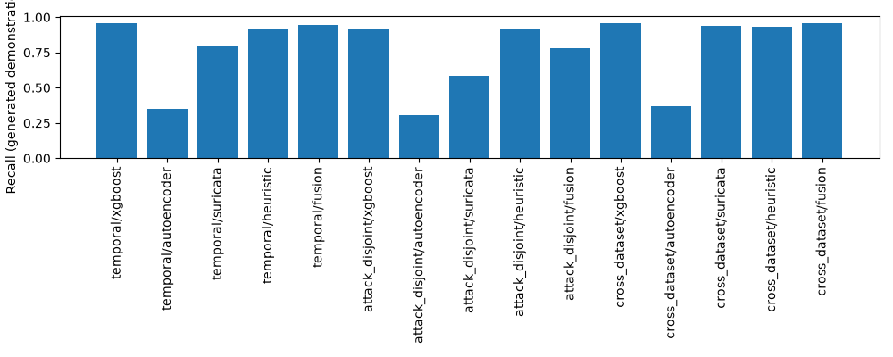

# Executed validation — 2026-10-11 cloud instance

These results are **generated-data/FakeLLM engineering demonstrations**, not public IDS benchmarks, hosted-model quality, or laptop measurements. No public data or PCAP is committed.

| Check | Current result |
|---|---|
| pytest | 105 executed tests passed |
| Ruff lint and format | Passed |
| Bandit | Passed with narrow documented fixed-subprocess/lab-listener exceptions |
| Installed + official CPU source-release advisory audit | Passed after CPU PyTorch upgrade; OS/native image vulnerability scanning is separate |
| Repeatable setup script | Executed successfully; preserved existing private .env |
| Startup/migrations | Idempotent Alembic upgrade; API, worker, dashboard, PostgreSQL healthy; authenticated bounded query passed |
| Tiny offline sensor fixture | Zeek conn/DNS and project-authored harmless DNS Suricata alert |
| Isolated lab capture | 20 rate-limited benign HTTP requests, 240 packets, zero capture drops |
| Lab checksum processing | Original preserved; only checksum fields repaired in derived copy; resulting 20 conn + 20 HTTP logs |
| Scope/network | Lab internal=true, 172.30.0.0/24; Nmap attached only to lab; no published scanner port or Docker socket |
| Live fixed-profile verification | Authorized .10 port 8000 and .11 port 8001 open; public target rejected before execution |
| Case workflow | PostgreSQL → LangGraph worker → authenticated admin approval → mock response passed |
| Audit DB mutation | UPDATE blocked by PostgreSQL trigger; hash-chained local audit verified |
| Detection harness | 45 method/seed/split evaluations completed on generated rows; SHAP/checkpoint restoration exercised |
| Agent comparison | 108 current-batch runs: 6 modes × 6 scenarios × 3 repeats |
| Safety corpus | 62 attempts blocked, 0 escaped; FakeLLM injection behavior is not real-model robustness |
| Dataset/provider follow-up | Source pages and full WTMC2021 paper read; manifest validation and hosted contract tested with mocks |
| Human review | 30 blank assignments linked to generated incident files; review **not performed** |

## FakeLLM comparison

| Mode | Decision accuracy | Consistency | Reference grounding | Failure rate | Mean latency (cloud seconds) |
|---|---:|---:|---:|---:|---:|
| multi | 0.333 | 1.000 | 1.000 | 0.000 | 0.0455 |
| pipeline | 0.333 | 1.000 | 1.000 | 0.000 | 0.0293 |
| single | 0.333 | 1.000 | 1.000 | 0.000 | 0.0073 |
| without_reviewer | 0.333 | 1.000 | 1.000 | 0.000 | 0.0513 |
| without_verification | 0.333 | 1.000 | 1.000 | 0.000 | 0.0480 |
| without_enrichment | 0.333 | 1.000 | 1.000 | 0.000 | 0.0520 |

FakeLLM always escalates and is correct on only 2/6 authored cases. Perfect consistency is deterministic behavior. Valid evidence IDs do not establish factual prose support. Ground-truth oracle simulator results are separated from actual agent proposals; FakeLLM does not contain malicious entities. All repeated comparisons use fresh batch IDs/caches to avoid confusing previous results with this run. Token estimates are labelled estimates; real provider usage/cost remains unmeasured.

## Generated detection demonstration

Validation-selected thresholds; all methods share the same one-pass threshold-search budget. The table shows 3-seed mean ± sample std. Generated family/dataset names do not represent public datasets. Exposure is an explicitly artificial benign day. Fixed-threshold results and per-family recall/conditional precision are retained locally in artifacts/detection/results.json. The binary models do not classify attack families.

| Split | Method | Precision | Recall | FPR | Alerts / artificial benign day |
|---|---|---:|---:|---:|---:|
| temporal | xgboost | 1.000 ± 0.000 | 0.958 ± 0.000 | 0.000 ± 0.000 | 0.000 ± 0.000 |
| temporal | autoencoder | 1.000 ± 0.000 | 0.347 ± 0.387 | 0.000 ± 0.000 | 0.000 ± 0.000 |
| temporal | suricata | 1.000 ± 0.000 | 0.792 ± 0.000 | 0.000 ± 0.000 | 0.000 ± 0.000 |
| temporal | heuristic | 1.000 ± 0.000 | 0.917 ± 0.000 | 0.000 ± 0.000 | 0.000 ± 0.000 |
| temporal | fusion | 1.000 ± 0.000 | 0.944 ± 0.024 | 0.000 ± 0.000 | 0.000 ± 0.000 |
| attack_disjoint | xgboost | 1.000 ± 0.000 | 0.917 ± 0.000 | 0.000 ± 0.000 | 0.000 ± 0.000 |
| attack_disjoint | autoencoder | 1.000 ± 0.000 | 0.306 ± 0.315 | 0.000 ± 0.000 | 0.000 ± 0.000 |
| attack_disjoint | suricata | 1.000 ± 0.000 | 0.583 ± 0.000 | 0.000 ± 0.000 | 0.000 ± 0.000 |
| attack_disjoint | heuristic | 1.000 ± 0.000 | 0.917 ± 0.000 | 0.000 ± 0.000 | 0.000 ± 0.000 |
| attack_disjoint | fusion | 1.000 ± 0.000 | 0.778 ± 0.048 | 0.000 ± 0.000 | 0.000 ± 0.000 |
| cross_dataset | xgboost | 1.000 ± 0.000 | 0.958 ± 0.000 | 0.000 ± 0.000 | 0.000 ± 0.000 |
| cross_dataset | autoencoder | 0.849 ± 0.098 | 0.369 ± 0.359 | 0.039 ± 0.005 | 4.667 ± 0.577 |
| cross_dataset | suricata | 1.000 ± 0.000 | 0.942 ± 0.000 | 0.000 ± 0.000 | 0.000 ± 0.000 |
| cross_dataset | heuristic | 1.000 ± 0.000 | 0.933 ± 0.000 | 0.000 ± 0.000 | 0.000 ± 0.000 |
| cross_dataset | fusion | 1.000 ± 0.000 | 0.956 ± 0.005 | 0.000 ± 0.000 | 0.000 ± 0.000 |

## Required external milestones

An initial proxy denial was resolved on retry: authoritative dataset terms, the WTMC2021 paper, and newer correction documentation were reviewed. See DATA_SOURCES.md and reports/source-review.json for the exact review scope. Exact corrected-archive rights and owner confirmation still need recording; a reviewed page is not a completed benchmark. Groq openai/gpt-oss-20b is selected from the current official SDK, with documented request/provenance tests; no private provider key is available. Public-data benchmarks, hosted model/provider credentials and permission to export telemetry, 30 human report reviews, and actual laptop measurements remain outstanding. Optional CrewAI/AutoGen and heavier GPU experiments are not implemented and have no results.

Full per-run evidence, raw logs, model weights and caches remain local under ignored data/artifacts/runtime directories. Publication of this code is not completion of those research milestones. See docs/PHASES.md and MODEL_CARD.md.
